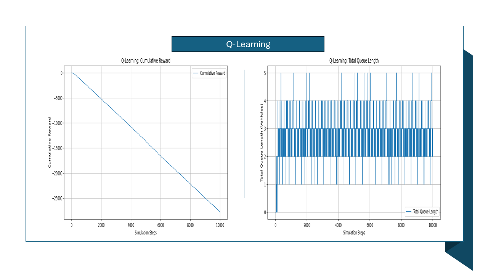

# Reinforcement-learning
Developing Q-Learning and Deep Q-Learning Algorithms for Traffic Signal Control and compare results with Static Traffic Signal
# Study Area
A random intersection
# Data Collection and Analysis
Required Data: 
a. Traffic Flow parameters: Traffic Volume-Default SUMO Values and Traffic Speed-Default SUMO Values
b. Traffic Behavioral Parameters: Lane Changing Model-Default SUMO Values and Car Following Model: Default SUMO Values
c. Vehicle Types: Default SUMO Values
# Base Model Development 
Required Steps: We have to create Network and name it properly. After that, we need to add traffic cars, volume and speed. After identifying vehicle types, detectors need to add. Finally, we need to compare 3 types of traffic lights, Fixed Timing, Q-Learning and Deep Q learning

Cumulative Reward and Queue Length Comparison of Fixed-Time, Q-Learning, and Deep Q-Learning:

### Fixed-Time Signal Control

### Q-Learning

### Deep Q-Learning (DQN)

